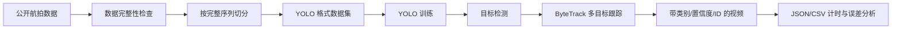

# Aerial Detection and Tracking

航拍车辆目标检测与多目标跟踪月度项目。

## 项目目标

使用公开航拍数据完成一条可复现的视觉数据闭环：读取数据、理解原始标注、按完整视频序列切分、转换为 YOLO 格式、训练轻量检测模型，再将检测结果接入多目标跟踪器，输出带类别、置信度和轨迹 ID 的结果视频。

本项目不接入 ROS 2、PX4、Gazebo 或真实飞控；本月只覆盖视觉检测、视频跟踪、指标和失败分析。

## 当前阶段

第 1 周：任务定义、数据来源、标注规则、序列切分、项目骨架和预训练基线。

## 数据源

主数据集：UAVDT-Benchmark-M。

相关官方资料：

- 数据集主页：https://sites.google.com/view/grli-uavdt
- DET/MOT toolkit：项目内的 data/UAVDT-DET-MOT-toolkit/
- Attributes：项目内的 data/UAVDT-Attributes/
- 访问日期：2026-11-08

原始类别：car、truck、bus。

第一版项目类别：单类 vehicle。

类别映射：

~~~text
car / truck / bus -> vehicle -> YOLO class 0
~~~

原始数据只用于本地研究和学习，不提交到 Git，也不公开上传可还原数据集的原始帧、标注、忽略区域或属性文件。

## 环境

- 系统：Ubuntu 22.04（WSL）
- Python：3.10.12
- 项目虚拟环境：.venv-project/
- 依赖文件：requirements.txt
- 精确环境记录：requirements-lock.txt

安装：

~~~bash
python3 -m venv .venv-project
source .venv-project/bin/activate
python -m pip install -r requirements.txt
~~~

## 数据和标注

原始图像按序列存放在 data/UAVDT-Benchmark-M/；完整检测标注在 data/UAVDT-DET-MOT-toolkit/GT/*_gt_whole.txt；跟踪真值在 *_gt.txt；忽略区域在 *_gt_ignore.txt。

详细规则见：

- data/README.md
- docs/annotation-guide.md
- docs/split-policy.md

转换后的 YOLO 数据仍放在 data/ 下但被 .gitignore 排除。原始目录不改写。

## 基线推理

预训练基线使用 Ultralytics 的轻量 YOLO 权重，仅用于观察通用模型在航拍画面上的表现，不代表本项目训练结果：

~~~bash
yolo predict \
  model=yolo26n.pt \
  source=path/to/video_a.mp4 \
  imgsz=640 \
  conf=0.25 \
  device=0 \
  save=True \
  save_txt=True \
  save_conf=True \
  project="$(pwd)/outputs/baseline" \
  name=video_a_yolo26n \
  2>&1 | tee outputs/baseline/video_a.log
~~~

## 评估指标

训练完成后记录 Precision、Recall、mAP50、mAP50-95、混淆矩阵和端到端 FPS；每项结果同时记录模型、数据版本、输入尺寸、阈值、硬件和计时范围。跟踪阶段额外记录 ID 切换、轨迹中断和短暂丢失。

## Git 边界

不提交：原始数据、转换数据、视频、模型权重、缓存、运行输出和包含数据内容的截图。提交代码、配置、数据卡、标注规则、切分清单、命令和汇总指标。


## 项目架构



## 训练与推理命令

### 完整基线训练

下面的命令固定本项目的模型、数据版本、输入尺寸、epoch、batch、随机种子和设备。重新运行时请修改 `name`，不要覆盖已有结果。

```bash
cd ~/project/03_aerial-detection-tracking
source .venv-project/bin/activate

PROJECT_ROOT="$(pwd)"
yolo detect train \
  model="$PROJECT_ROOT/yolo26n.pt" \
  data="$PROJECT_ROOT/configs/dataset_v0.2.yaml" \
  imgsz=640 epochs=50 batch=4 seed=20261112 \
  device=0 deterministic=True workers=2 \
  project="$PROJECT_ROOT/runs/week3_day2" \
  name=baseline_full_v0.2 exist_ok=False cache=False
```

### 检测加跟踪

三个视频使用相同模型和参数；这样得到的差异来自视频内容，而不是参数变化。脚本同时输出带 ID 的视频和 `.timing.json/.timing.csv`。

```bash
MODEL=runs/week3_day2/baseline_full_v0.2/weights/best.pt
TRACKER=bytetrack.yaml

python3 scripts/evaluate_video.py \
  --video ~/project/study_3/01/day3/inputs/video_a.mp4 \
  --model "$MODEL" \
  --output runs/week4_day4/video_a_bytetrack.avi \
  --tracker "$TRACKER" --imgsz 640 --conf 0.20 --iou 0.60

python3 scripts/evaluate_video.py \
  --video ~/project/study_3/01/day3/inputs/video_b.mp4 \
  --model "$MODEL" \
  --output runs/week4_day4/video_b_bytetrack.avi \
  --tracker "$TRACKER" --imgsz 640 --conf 0.20 --iou 0.60

python3 scripts/evaluate_video.py \
  --video ~/project/study_3/04/day4/inputs/video_c_pixabay_327970.mp4 \
  --model "$MODEL" \
  --output runs/week4_day4/video_c_bytetrack.avi \
  --tracker "$TRACKER" --imgsz 640 --conf 0.20 --iou 0.60
```

## 已有指标

### 检测指标

| 实验 | 切分 | 图像/实例 | Precision | Recall | mAP50 | mAP50-95 | 参数 |
|---|---|---:|---:|---:|---:|---:|---|
| 完整基线 epoch 50 | val | 216 / 4,229 | 0.82280 | 0.81178 | 0.83017 | 0.52222 | `imgsz=640` |
| 冻结测试评估 | test | 673 / 15,257 | 0.761 | 0.628 | 0.589 | 0.323 | `imgsz=640, conf=0.20, NMS IoU=0.60` |

测试集只评估一次，未用于训练、模型选择或阈值反复调整。测试日志：`outputs/week3_day6_frozen_test.log`。

### 跟踪与速度指标

端到端 FPS 包含解码、检测+跟踪、绘制和写出；计算 FPS 只包含检测+跟踪和绘制。

| 视频 | 输入/输出帧数 | 输入 FPS | 端到端 FPS | 计算 FPS |
|---|---:|---:|---:|---:|
| video_a | 2,824 / 2,824 | 30.00 | 16.661 | 37.821 |
| video_b | 3,076 / 3,076 | 30.00 | 16.113 | 34.706 |
| video_c（独立来源） | 318 / 318 | 59.94 | 15.397 | 32.247 |

原始计时文件位于 `runs/week4_day4/*.timing.json` 和 `*.timing.csv`。

## 失败案例

检测阶段的 FP、FN、小目标、遮挡、运动模糊、背景相似和边界截断案例，见 [docs/week3-record.md](docs/week3-record.md)。其中记录的是“现象—可能原因—下一步验证”，可能原因没有被写成已证明结论。

第 4 周第 5 天的 ID 切换、轨迹中断和错误延续，需要根据三个带 ID 视频人工复核后填写；没有人工确认前，不把这些数量写成零，也不把自动轨迹数量当成 MOT 指标。

## 已知限制

- 当前只训练一个类别：`vehicle`，没有区分 car、truck 和 bus。
- 小目标、遮挡、运动模糊和背景相似时可能出现漏检或框偏移。
- ByteTrack 使用 Ultralytics 提供的成熟实现，没有修改算法核心。
- 当前没有计算完整的 MOTA、IDF1 等 MOT 指标。
- 独立视频 C 只有约 5.3 秒，只适合验证独立来源流程，不足以覆盖长时间遮挡和重新出现。
- 测试集只做冻结评估，不能把测试结果解释为可继续调参的验证结果。
- 公开视频和原始 UAVDT 数据只保留本地，不上传 GitHub。

## 第 6 天：新环境小样例验证

验证目标是确认“新环境 → 加载模型 → 读取视频 → 检测 → 跟踪 → 写出结果”整条链路可启动，不重新训练。

```bash
cd ~/project/03_aerial-detection-tracking
python3 -m venv /tmp/week4-day6-verify
source /tmp/week4-day6-verify/bin/activate
python -m pip install --upgrade pip
python -m pip install -r requirements.txt
python scripts/evaluate_video.py --help
```

已在全新临时环境 /tmp/week4-day6-verify 中完成 video C 小样例验证：输入/输出帧数 318/318，端到端 FPS 15.125，计算 FPS 33.536，实际耗时约 22.7 秒；输出为 /tmp/week4-day6-check/video_c_check.avi，并生成对应计时 JSON/CSV。首次运行自动补装了 lap 0.5.14，已将 lap>=0.5.12 加入 requirements.txt，并在 requirements-lock.txt 固定为 0.5.14。

## 复现边界

提交代码、配置、数据卡、标注规则、切分规则和汇总指标；原始图像、原始标注、视频、模型权重、缓存和运行输出默认由 `.gitignore` 排除。
